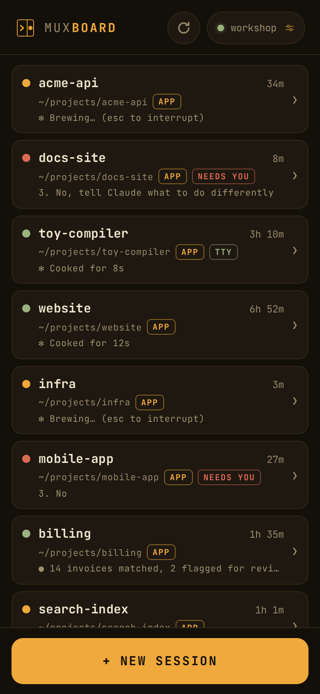
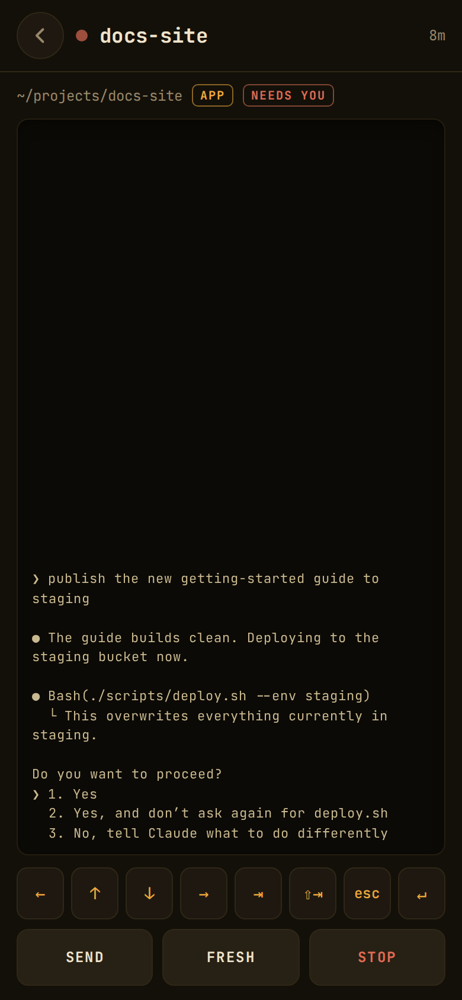
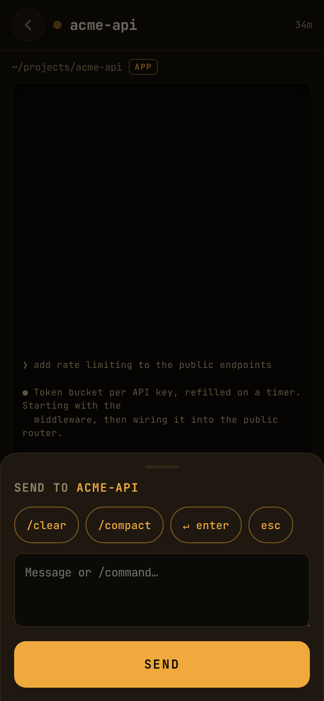
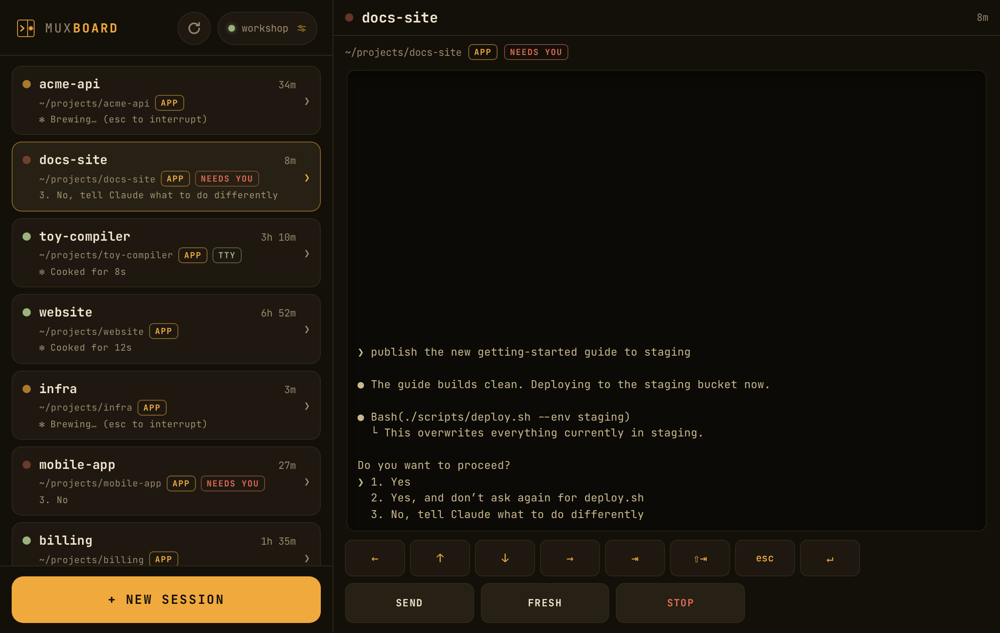
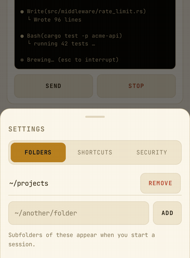

# Muxboard

A mobile-first PWA for managing [Claude Code](https://code.claude.com) sessions
that live in tmux on an always-on machine. *(mux, as in multiplexer — the tmux
kind.)*

It is built for one workflow: your sessions run on a box at home (or a VPS), you
talk to them from the Claude app on your phone via Remote Control, and you need
a fast way to **see / start / poke / stop** those sessions from that same phone.
Muxboard is the session manager, not another terminal.

<p align="center">
  
  
  
</p>
<p align="center">
  
</p>

Each session is one tmux session running `claude --remote-control`, so it is
simultaneously:

- visible in the Claude app (work from anywhere),
- attachable from a desktop terminal (`tmux attach -t <name>` — full TUI,
  `/rewind` and `/clear` included),
- manageable from this dashboard.

## What the dashboard does

- **Session list** — one row per tmux session running Claude: a status light
  (working / idle / needs you), uptime, badges for app-reachability and desktop
  attachment, and the last line on its screen, so a dozen sessions still fit
  on one phone screen. Tap a row to open it; on a wide screen the list and the
  open session sit side by side.
- **Live screen** — the open session's terminal (bottom-anchored, scroll up for
  history), with a keypad underneath: arrows, tab, shift+tab, esc and enter,
  for the TUI's menus and permission prompts. On a desktop, click the screen
  and the arrow keys, enter and esc go straight through.
- **New session** — tap a folder from your configured roots, or type any path
  under `~`; a detached tmux session starts `claude --remote-control` there and
  shows up in the Claude app within seconds. Optional toggle to resume the
  folder's last conversation (`--continue`).
- **Send keys** — inject input into a session's TUI via `tmux send-keys`: your
  own shortcut chips (`/clear` is handy — the Claude app can't do it remotely),
  plus a free-text field for any message or command. Slash commands get a short
  delay before Enter so the TUI's autocomplete settles.
- **Fresh chat** — once a long session's prompt cache has expired, any further
  turn (a `/compact` included) re-ingests the entire context at full token
  cost. **fresh** (tap twice to confirm) sidesteps that: it looks up the
  session's transcript UUID, sends `/clear` — a local TUI command, no model
  turn — and then invokes your restore command with that UUID, so the new
  context can mine the old transcript for just what it needs. Requires a
  skill or slash command in your Claude Code setup that accepts a session
  UUID (name configurable via `rolloverCommand`, default `/restore`); only
  offered while the session is idle.
- **Warm handoff** — the prompt cache of a main Claude Code session lasts an
  hour on a subscription. When a session has sat idle for `idleMinutes`
  (default 50) with more than `minTokens` of context (default 200k), Muxboard
  types your handoff command (default `/handoff`) into it once, while the cache
  is still warm. Nothing is cleared: the session stays idle with a handoff
  written, and the detail view shows "handoff sent hh:mm". It fires only when
  the session is idle with an empty input line, never past 58 minutes idle, and
  not again until you send the session a new prompt. Each session has an **auto
  handoff** switch; `warmHandoff.enabled` sets its default.
- **Accounts** — Claude Code picks its account from `CLAUDE_CONFIG_DIR`
  (unset means `~/.claude`). If your login shell sets it, Muxboard shows each
  session's account as a badge (`~/.claude-b` shows as `b`), names the account
  new sessions will start in, and highlights sessions running in a different
  one. **reopen in …** (tap twice) restarts an idle session in the active
  account under the same name. The prompt cache is per account, so the reopened
  session starts cold either way: a context of up to `freshAbove` tokens is
  resumed as is; a bigger one starts fresh and gets your restore command with
  the old transcript's UUID, as **fresh** does. With a single account none of
  this appears.
- **Account management** (optional) — with an account tool configured
  (`accounts.list`, see below), settings gets an **accounts** tab. Each account
  shows its label (tap to rename), name, email, plan, whether it is logged
  in and when the login runs out (amber in its last week; read from the
  account's `.credentials.json`, so not on macOS), with **use** to make it the account new sessions start in and **log in**
  to sign it in from the phone: Muxboard runs `claude auth login --claudeai`
  in a hidden tmux session, shows the sign-in URL as a link, and types the code
  you paste back into that session. On Android, the installed app opens the
  link in the default browser rather than an in-app tab, a **paste** button
  fills in the code, and a login still waiting keeps its code box when you
  come back to the tab. A field below the list creates an account.
  Without a working `accounts.list` — none configured, or the program missing
  or failing — the tab, labels, login and add stay hidden and Muxboard runs
  none of these commands; it logs the failure once and tries again when the
  config changes or after five minutes.
- **Stop** — kill the tmux session (tap twice to confirm).
- **Update + rolling restart** — run `claude update` from the app; sessions
  keep running their old binary until restarted, so Muxboard flags stale
  sessions and can recycle each one with `--continue` (same conversation, same
  account, new version) as soon as it goes idle.
- **Reboot restore** — the server snapshots the open session set as it polls;
  after a reboot the app offers one-tap restore of each folder's last
  conversation.
- **Offline screen** — the shell is cached by a service worker, so with the VPN
  off the app still opens, says so, and reconnects by itself.

## Requirements

- **Linux.** Session and version detection read `/proc`, so macOS is not
  supported (parts of the UI will simply come up empty there).
- **Node.js 20+** — no runtime dependencies, no build step.
- **tmux 3.x** — pane targets use the `=name:` exact-match form.
- **Claude Code** installed for the same user, with a Claude account that can
  use Remote Control.

## Install

```sh
git clone https://github.com/aiongg/muxboard.git
cd muxboard
node server.mjs          # http://127.0.0.1:8800
```

Open it, tap **new session**, pick a folder — the session appears in the Claude
app shortly after.

Muxboard binds to localhost only. To use it from a phone, see *Reaching it from
your phone* below.

## Configure

<p align="center">
  
</p>

Muxboard follows your system light/dark theme; the terminal screens stay dark in
both.

Settings live in `~/.config/muxboard/config.json`, editable from the app or
by hand:

```json
{
  "roots": ["~/projects", "~/work"],
  "shortcuts": [
    { "label": "/clear", "send": "/clear" },
    { "label": "yes", "send": "yes, go ahead" },
    { "label": "↵ enter", "key": "enter" },
    { "label": "esc", "key": "escape" }
  ],
  "rolloverCommand": "/restore",
  "warmHandoff": { "enabled": true, "idleMinutes": 50, "minTokens": 200000, "command": "/handoff" },
  "accounts": {
    "freshAbove": 100000,
    "list": ["~/bin/accounts", "names"],
    "use": ["~/bin/accounts", "use", "{name}"],
    "dir": ["~/bin/accounts", "dir", "{name}"],
    "add": ["~/bin/accounts", "add", "{name}"],
    "labels": { "work": "Work (max)" }
  }
}
```

- **`roots`** — folders whose immediate subdirectories are offered when starting
  a session (max 8). Must resolve to a real path inside `$HOME`; symlinks
  pointing outside it are rejected.
- **`shortcuts`** — the chips in the send sheet (max 12). Use `send` for text or
  a slash command (200 chars), or `key` for a keypress: `enter`, `escape`,
  `up`, `down`, `left`, `right`, `tab`, `btab` (shift+tab) or `backspace`;
  labels are capped at 24 characters. In the app's add form, type `@enter`,
  `@up`, `@shift-tab` and so on to create a keypress chip.
- **`rolloverCommand`** — the slash command **fresh** runs in the cleared
  session, invoked as `<rolloverCommand> <previous-session-uuid>`. Point it at
  a skill that restores context by reading the previous transcript
  (`~/.claude/projects/<munged-cwd>/<uuid>.jsonl`) selectively.
- **`warmHandoff`** — the warm handoff above. `enabled` is the default for
  each session's switch; `idleMinutes` is 1–55; `minTokens` counts the last
  answer's input plus cache-read and cache-write tokens; `command` is a slash
  command or plain text, one line, 200 chars. Point it at a skill that writes a
  handoff file.
- **`accounts`** — multiple Claude accounts (see *Accounts* above).
  `freshAbove` (default 100000) is the largest context, counted like
  `minTokens`, that **reopen** resumes; a bigger one starts fresh from the
  transcript. A context is also resumed only when the new account's
  `projects/` folder can see the old transcript; otherwise reopen starts fresh,
  and your restore command must find the transcript in the other account's
  folder. `list`, `use`, `dir` and `add` are optional commands, each an argv
  array run without a shell (a leading `~/` in the program path is expanded).
  They are read from the config file only: saving settings from the app keeps
  the stored values and ignores any the app sends. In `use`, `dir` and `add`,
  `{name}` is replaced by the account name. Names must match
  `[a-z0-9][a-z0-9_-]{0,39}`.
  - `list` prints one account name per line. Every other account feature
    needs it to run cleanly.
  - `use` switches the account your login shell gives new sessions. The
    active account is whatever a login shell (`zsh -lc`) sets as
    `CLAUDE_CONFIG_DIR`, so `use` has to change what a new login shell sets.
  - `dir` prints the account's config dir (absolute or `~/…`), or nothing for
    the default `~/.claude`. Badges and the active account then show the
    tool's names, and the accounts tab can show sign-in state (from
    `claude auth status`, cached for a minute) and offer **log in**. Without
    it, a dir like `~/.claude-b` shows as `b`.
  - `add` creates an account.
  - `labels` maps account names to display names (at most 32 characters),
    shown on badges, buttons and the accounts tab. The app edits them; an empty
    label removes the entry.

  Muxboard only runs the login shell when `list` works or some session uses a
  non-default account.

Environment overrides:

| Variable           | Default               | Meaning                              |
| ------------------ | --------------------- | ------------------------------------ |
| `PORT`             | `8800`                | Listen port                          |
| `HOST`             | `127.0.0.1`           | Listen address — leave it on loopback |
| `MUX_ROOT`         | `$HOME`               | Seeds `roots` on first run           |
| `MUX_CLAUDE`       | `~/.local/bin/claude` | Claude Code binary                   |
| `XDG_CONFIG_HOME`  | `~/.config`           | Where `muxboard/config.json` lives  |
| `XDG_STATE_HOME`   | `~/.local/state`      | Where `muxboard/` state files live   |

Session state is snapshotted to `~/.local/state/muxboard/snapshot.json`.
Per-session handoff switches and sent handoffs are kept in `handoff.json`
beside it, so a restart neither forgets a switch nor sends a handoff twice.

## Password (optional)

Muxboard asks for nothing by default. Set a password from **settings** in the
app, or from a terminal:

```sh
node scripts/password.mjs           # prompts, stores the hash
node scripts/password.mjs --remove  # back to no password
```

Every other device then gets a login screen; the one that set it stays signed
in. Sessions last 30 days and survive service restarts, and **log out** sits
next to the password controls. Changing or removing the password always
requires the current one, and signs out every device. Changes take effect
immediately — no restart needed.

Set it via the prompt rather than as a shell argument: arguments land in your
shell history, and — since Muxboard streams terminal screens — in its own
session peeks.

The password is stored as a scrypt hash in `~/.config/muxboard/auth.json`
(mode `0600`), deliberately not in `config.json`, which is sent to the browser
on every poll. Session cookies are HMAC-signed with a secret that rotates on
each password change, and are `HttpOnly` + `SameSite=Strict` (plus `Secure`
when Muxboard is reached over HTTPS). Failed logins are throttled.

## Run it as a service

```ini
# ~/.config/systemd/user/muxboard.service
[Unit]
Description=Muxboard — Claude Code session dashboard

[Service]
Type=exec
WorkingDirectory=%h/muxboard
# Use an absolute node path — `command -v node` — since systemd user units
# don't run your shell's profile (nvm/fnm/volta installs are not on PATH here).
ExecStart=/usr/bin/node %h/muxboard/server.mjs
Environment=PORT=8800
Restart=always
# Critical: Muxboard spawns tmux, so the tmux server may live in this unit's
# cgroup. Without this, restarting Muxboard kills every Claude session on the box.
KillMode=process

[Install]
WantedBy=default.target
```

```sh
systemctl --user enable --now muxboard
loginctl enable-linger "$USER"     # keep it running when you log out
```

## Reaching it from your phone

Installing a PWA requires a secure context, so you need HTTPS (or localhost).
Pick whichever fits:

**Tailscale (easiest, no DNS or certificates of your own).** With MagicDNS and
HTTPS certificates enabled in your tailnet:

```sh
tailscale serve --bg 8800
```

Muxboard is then at `https://<machine>.<tailnet>.ts.net` for your devices only, with
a real certificate — installable as a PWA, no port forwarding, nothing public.
If something else already owns `:443` on that host, use a distinct port instead:
`tailscale serve --bg --https=8443 8800`.

**Disable key expiry on the host.** Tailscale node keys expire after 180 days by
default, and an expired key drops the machine off the tailnet until someone
reauthenticates it at a terminal — which is exactly what you can't do when the
box is a VPS you reach through Muxboard. In the admin console, open **Machines**,
find the host, and choose **Disable key expiry** from its menu. Tailscale
recommends this for always-on servers and hard-to-reach devices.

**Your own domain behind a reverse proxy.** If you already run one, point a
hostname at `127.0.0.1:8800` and restrict it to your VPN — for example with
Caddy:

```
muxboard.example.com {
    reverse_proxy 127.0.0.1:8800
}
```

**Desktop only.** `http://localhost:8800` is already a secure context, so Chrome
will install it as an app with no extra setup.

## Security

**There is no authentication unless you set a password** (see above). Without
one, anyone who can reach the port can start Claude Code in your files, send
input to your sessions, and read your transcripts.

A password is worth setting, but it is a lock on the door rather than a moat:
keep `HOST` on loopback and put Muxboard behind something that limits who
can reach it — a tailnet, a VPN, or an authenticating proxy. Do not expose it
to the public internet.

Muxboard does reject cross-site requests: browsers will happily send a "simple"
POST from any page to `localhost:8800` without asking anyone's permission, so
requests carrying a foreign `Origin` or `Sec-Fetch-Site` are refused. That
closes the drive-by path where a web page you visit types into your sessions;
it is not a substitute for putting a real access control in front of Muxboard.

Terminal screens are transmitted verbatim, so anything visible in a session —
including a secret someone typed into it — is served to whoever can reach
Muxboard.

Sessions run with your user's privileges and `roots` are confined to `$HOME`,
but that is a guardrail against mistakes, not a sandbox: a session started in a
folder can read anything your user can.

## Develop

No build step; the frontend is vanilla HTML/CSS/JS in `public/`.

```sh
node scripts/demo.mjs    # http://127.0.0.1:8801 — the UI with invented sessions
pnpm icons               # re-render icons from public/icons/icon.svg (needs sharp)
```

Bump `VERSION` in `public/sw.js` with every frontend change, or installed PWAs
keep serving cached assets.

The peek filter in `server.mjs` (`peek()` / `isChromeFooter()`) strips Claude
Code's TUI chrome and infers status from rendered text, so it is sensitive to
Claude Code's TUI layout. If peeks turn noisy or status detection misbehaves
after a Claude Code update, that is the place to look.

## License

MIT — see [LICENSE](LICENSE). Bundled JetBrains Mono is licensed under the SIL
Open Font License 1.1 (`public/fonts/OFL.txt`).

Muxboard is an independent project, not affiliated with, sponsored by, or
endorsed by Anthropic. Claude and Claude Code are trademarks of Anthropic and
are used here only to describe what this tool works with.
